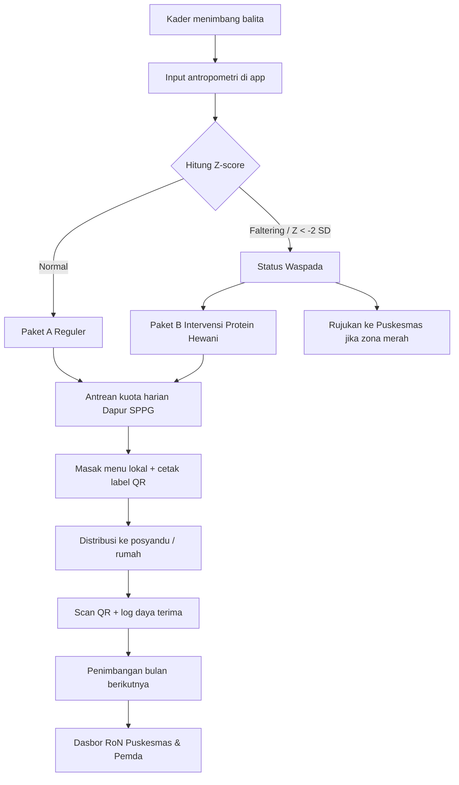
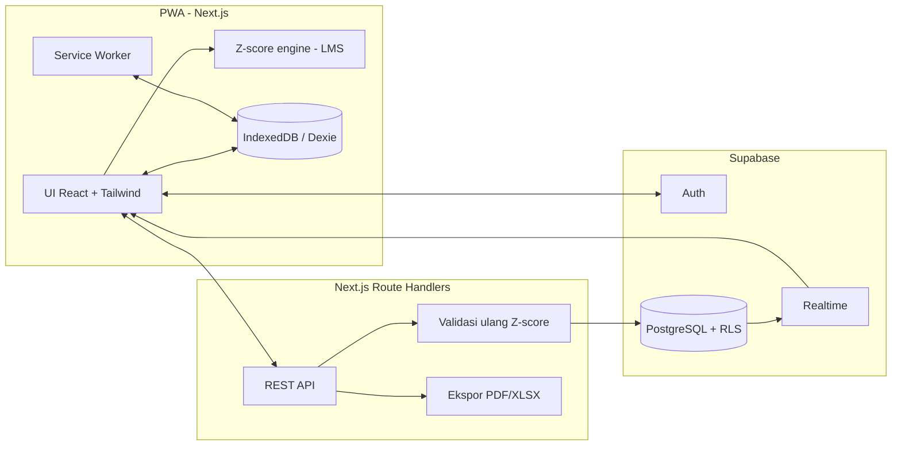

# PRD — NutriTrack Jatim

**Sistem Presisi Intervensi Stunting & Pemantauan Makan Bergizi Gratis (MBG) Provinsi Jawa Timur**

| Item | Detail |
| --- | --- |
| Versi dokumen | 1.0 (turunan dari SKPL NutriTrack Jatim v1.0) |
| Jenis produk | Web app responsif, mobile-first, PWA (offline-ready) |
| Kategori | Kesehatan masyarakat, SDGs #2 & #3, MBG, ketahanan pangan lokal Jatim |
| Wilayah target | Wilayah prioritas penurunan stunting Jawa Timur (Madura, Jember, Bondowoso, Probolinggo, dll.) |
| Tujuan dokumen | Acuan tunggal untuk membangun website (desain, frontend, backend, database) |

> **Catatan konvensi:** Item bertanda **[TAMBAHAN PRD]** adalah hal yang tidak tertulis eksplisit di SKPL, tetapi diperlukan agar sistem bisa dibangun utuh. Item tanpa tanda bersumber langsung dari SKPL. Bagian 17 merangkum asumsi dan celah SKPL yang perlu kamu putuskan.

---

## 1. Ringkasan Produk

### 1.1 Visi
NutriTrack Jatim mengubah data penimbangan balita di posyandu menjadi **keputusan menu MBG yang presisi** pada hari yang sama, lalu membuktikan dampaknya pada kurva pertumbuhan anak.

### 1.2 Masalah yang Diselesaikan
1. **Pencatatan lambat dan tidak real-time.** Buku KMS kertas mudah rusak, tercecer, dan telat dianalisis.
2. **Keterlambatan intervensi dini.** Growth faltering (berat badan mendatar atau turun 2 bulan berturut-turut) terdeteksi terlambat sampai menjadi stunting permanen.
3. **Distribusi MBG tidak personal.** Porsi dan gizi disamaratakan, padahal baduta bergizi kurang butuh protein hewani lebih tinggi.
4. **Tidak ada alat evaluasi terukur.** Belum ada instrumen Return on Nutrition (RoN) yang menghubungkan pemberian makanan dengan perbaikan antropometri.

### 1.3 Proposisi Nilai per Pemangku Kepentingan
| Pemangku kepentingan | Nilai yang diterima |
| --- | --- |
| Kader & orang tua | Kalkulator Z-score otomatis (standar Kemenkes/WHO), deteksi dini instan di posyandu |
| Dapur MBG (SPPG) | Kuota Paket Reguler vs Paket Intervensi otomatis, tepat sasaran |
| Petani/peternak lokal | Pengadaan langsung dari peternak (telur Blitar, lele Lamongan), rantai pasok lebih pendek |
| Puskesmas & Pemda | Dasbor analitik sebaran gizi dan dampak program berbasis data riil |

### 1.4 Diferensiasi Utama
Sistem **bukan hanya pencatat, tetapi pengambil keputusan**: data timbangan otomatis menjadi daftar menu yang harus dimasak hari itu.

---

## 2. Tujuan & Metrik Keberhasilan

### 2.1 Tujuan Produk
| ID | Tujuan |
| --- | --- |
| G1 | Kader dapat mencatat penimbangan dan mendapat status gizi dalam < 60 detik per anak |
| G2 | Anak growth faltering teridentifikasi otomatis dan masuk antrean Paket B di hari yang sama |
| G3 | Dapur SPPG menerima rekap kuota harian dan kebutuhan bahan baku tanpa hitung manual |
| G4 | Setiap paket MBG dapat dilacak ke anak penerima lewat QR |
| G5 | Pemda dapat melihat sebaran stunting dan tren Z-score vs konsumsi MBG pada siklus 30/60/90 hari |

### 2.2 Metrik (KPI) [TAMBAHAN PRD — target awal, sesuaikan]
| Metrik | Target awal |
| --- | --- |
| Waktu input + hasil status gizi per anak | ≤ 60 detik |
| Akurasi kalkulator Z-score vs tabel rujukan resmi | 100% pada kasus uji (toleransi ±0,01 SD) |
| Persentase data penimbangan yang berhasil sinkron setelah offline | ≥ 99% |
| Paket MBG yang terverifikasi QR | ≥ 90% dari paket terdistribusi |
| Waktu muat halaman utama di jaringan 3G | ≤ 3 detik |
| Skor Lighthouse (Performance, PWA) | ≥ 85 |

### 2.3 Di Luar Lingkup (Non-Goals) Versi 1.0 [TAMBAHAN PRD]
- Aplikasi native Android/iOS (cukup PWA).
- Diagnosis medis otomatis. Sistem hanya memberi status gizi dan rekomendasi, keputusan klinis tetap di petugas gizi.
- Integrasi langsung ke sistem nasional (e-PPGBM, SATUSEHAT). Bisa jadi fase lanjutan.
- Pembayaran/transaksi keuangan ke pemasok. Sistem hanya mencatat log pembelian.

---

## 3. Pengguna & Hak Akses (RBAC)

### 3.1 Peran
| Role (kode) | Platform utama | Hak akses & tindakan | Output |
| --- | --- | --- | --- |
| **Kader Posyandu / Orang Tua** (`kader`, `parent`) | Mobile-first (PWA/smartphone) | Input antropometri balita; lihat kurva KMS digital; konfirmasi terima paket MBG via QR | Data penimbangan, status Z-score, log penerimaan makanan |
| **Pengelola Dapur MBG / SPPG** (`kitchen`) | Tablet/laptop dapur | Lihat rekap kuota harian; akses katalog resep lokal; input log belanja bahan baku | Jadwal porsi masak, label QR paket, nota belanja lokal |
| **Petugas Gizi Puskesmas** (`puskesmas`) | Desktop/PC | Validasi rujukan anak zona merah; keluarkan rekomendasi medis; pantau desa di wilayah kerjanya | Verifikasi rujukan, resep terapi gizi lanjutan |
| **Dinas Kesehatan / TPID Jatim** (`dinkes`) | Desktop monitor besar | Lihat heatmap stunting; evaluasi grafik Z-score vs MBG; unduh laporan audit | Laporan capaian prevalensi, audit anggaran MBG |
| **Admin Sistem** (`admin`) **[TAMBAHAN PRD]** | Desktop | Kelola pengguna, wilayah, posyandu, dapur, master resep | Data master terkelola |

> **Keputusan perlu dikonfirmasi:** SKPL menggabungkan Kader dan Orang Tua pada satu baris. PRD ini memisahkannya menjadi dua role teknis (`kader` dan `parent`) dengan izin berbeda (lihat 3.2).

### 3.2 Matriks Izin (ringkas) [TAMBAHAN PRD]
| Sumber daya | kader | parent | kitchen | puskesmas | dinkes | admin |
| --- | --- | --- | --- | --- | --- | --- |
| Data anak (buat/ubah) | Posyandu sendiri | Tidak | Tidak | Lihat wilayah | Lihat agregat | Penuh |
| Data penimbangan | Buat/lihat posyandu sendiri | Lihat anak sendiri | Tidak | Lihat wilayah kerja | Agregat | Penuh |
| Kurva KMS | Lihat | Lihat anak sendiri | Tidak | Lihat | Agregat | Lihat |
| Rekap kuota & daftar masak | Tidak | Tidak | Dapur sendiri | Lihat | Lihat | Lihat |
| Resep MBG | Lihat | Lihat | Lihat | Lihat | Lihat | Kelola |
| Scan QR terima paket | Ya | Ya (anak sendiri) | Tidak | Tidak | Tidak | Tidak |
| Log konsumsi | Buat | Buat (anak sendiri) | Lihat agregat | Lihat | Agregat | Lihat |
| Validasi rujukan | Tidak | Tidak | Tidak | Ya | Tidak | Tidak |
| Heatmap & RoN | Tidak | Tidak | Tidak | Wilayah kerja | Seluruh Jatim | Lihat |
| Ekspor laporan | Tidak | Tidak | Tidak | Wilayah kerja | Ya | Ya |
| Kelola pengguna & master data | Tidak | Tidak | Tidak | Tidak | Tidak | Ya |

Pembatasan data dilakukan di level database dengan **Row-Level Security (RLS) Supabase**, bukan hanya di UI.

---

## 4. Alur Kerja End-to-End

| Langkah | Aktor | Deskripsi |
| --- | --- | --- |
| 1 | Kader | Menimbang balita di balai desa, menginput data ke NutriTrack di ponsel |
| 2 | Sistem | Menghitung Z-score WHO/Permenkes; jika BB/TB < -2 SD atau berat badan datar/turun 2 bulan berturut-turut, status **Growth Faltering / Waspada** aktif otomatis |
| 3 | Sistem → Dapur | Pesanan presisi dikirim ke dasbor Dapur MBG terdekat, contoh: "Balita A butuh Paket B (tinggi protein hewani lokal)" |
| 4 | Dapur SPPG | Memasak sesuai porsi di dasbor dengan pasokan lokal, menempelkan label QR unik per kotak |
| 5 | Kader/Orang tua | Paket diantar ke posyandu/rumah; kader atau orang tua scan QR dan memilih status konsumsi anak |
| 6 | Puskesmas & Pemda | Bulan berikutnya anak ditimbang lagi; dasbor memetakan perubahan Z-score untuk membuktikan efektivitas MBG |

### Diagram alur


---

## 5. Kebutuhan Fungsional

Setiap fitur memakai ID SKPL asli. Prioritas: **P0** = wajib untuk MVP, **P1** = penting, **P2** = bisa menyusul.

### 5.1 Modul A — Smart KMS Digital & Deteksi Dini (Kader)

#### SKPL-F01 — Input Cepat Antropometri `P0`
**Deskripsi:** Input tanggal lahir, jenis kelamin, berat badan (kg), panjang/tinggi badan (cm), dan lingkar kepala dengan cepat.

**Kriteria penerimaan:**
- Form menampilkan: pilih anak (cari nama/NIK), tanggal pengukuran (default hari ini), BB, PB/TB, lingkar kepala (opsional).
- Usia (bulan) dihitung otomatis dari tanggal lahir dan tanggal ukur.
- Validasi rentang masuk akal **[TAMBAHAN PRD]**: BB 1–30 kg, PB/TB 35–125 cm, lingkar kepala 25–60 cm; di luar rentang tampil peringatan konfirmasi, bukan blokir keras.
- Cara ukur otomatis: usia < 24 bulan = **panjang badan** (terlentang), ≥ 24 bulan = **tinggi badan** (berdiri); sistem menampilkan label yang sesuai dan koreksi ±0,7 cm bila cara ukur tidak cocok dengan usia **[TAMBAHAN PRD, standar WHO]**.
- Input numerik besar, ramah jempol, keypad numerik muncul otomatis.
- Dapat menambah anak baru (NIK, nama, tanggal lahir, jenis kelamin, nama ibu, alamat) dari layar yang sama.
- Tersimpan lokal terlebih dahulu (lihat F05), lalu sinkron.

#### SKPL-F02 — Kalkulator Z-Score Otomatis `P0`
**Deskripsi:** Perhitungan instan standar Kemenkes/WHO untuk **BB/U**, **TB/U (stunting)**, dan **BB/TB (wasting)**.

**Kriteria penerimaan:**
- Z-score dihitung dengan metode LMS standar WHO Child Growth Standards (0–60 bulan) per jenis kelamin.
- Hasil: tiga nilai Z-score + kategori status (lihat 5.1.1).
- Perhitungan berjalan **di sisi klien** sehingga berfungsi offline, dan **diverifikasi ulang di server** saat sinkron (server sebagai sumber kebenaran).
- Hasil muncul < 1 detik setelah tombol "Hitung Status Gizi".
- Tabel LMS disimpan sebagai data statis (JSON) di aplikasi dan di tabel referensi database **[TAMBAHAN PRD]**.
- Unit test wajib dengan kasus uji dari tabel resmi (lihat 12.3).

##### 5.1.1 Kategori Status (Permenkes No. 2 Tahun 2020 tentang Standar Antropometri Anak) [TAMBAHAN PRD — verifikasi ulang dengan ahli gizi]
| Indeks | Kategori | Ambang Z-score |
| --- | --- | --- |
| BB/U | Berat badan sangat kurang | < -3 SD |
| | Berat badan kurang | -3 s/d < -2 SD |
| | Berat badan normal | -2 s/d +1 SD |
| | Risiko berat badan lebih | > +1 SD |
| TB/U | Sangat pendek (severely stunted) | < -3 SD |
| | Pendek (stunted) | -3 s/d < -2 SD |
| | Normal | -2 s/d +3 SD |
| | Tinggi | > +3 SD |
| BB/TB | Gizi buruk (severely wasted) | < -3 SD |
| | Gizi kurang (wasted) | -3 s/d < -2 SD |
| | Gizi baik | -2 s/d +1 SD |
| | Berisiko gizi lebih / lebih / obesitas | > +1 SD |

Nilai Z-score di luar ±5 SD ditandai "data meragukan" dan diminta konfirmasi ulang pengukuran (praktik flag WHO).

`status_nutrition` (ringkasan) mengambil kondisi terburuk dari ketiga indeks dengan urutan prioritas: gizi buruk > stunting berat > gizi kurang/stunting > growth faltering > normal.

#### SKPL-F03 — Kurva KMS Digital Interaktif `P0`
**Deskripsi:** Plotting kurva dengan zona warna **hijau (normal)**, **kuning (waspada)**, **merah (stunting/gizi kurang)**.

**Kriteria penerimaan:**
- Kurva per indeks (BB/U, TB/U, BB/TB) dengan garis kurva median dan pita ±1/±2/±3 SD.
- Titik penimbangan anak terplot dan terhubung garis; titik terbaru disorot.
- Interaktif: tap titik menampilkan tanggal, usia, nilai ukur, dan Z-score.
- Warna kurva mengikuti status terakhir; teks status selalu menyertai warna (aksesibilitas buta warna).
- Dapat dilihat offline dari data terakhir yang tersimpan.
- Pustaka: Recharts atau Chart.js (lihat bagian 9).

#### SKPL-F04 — Early Warning Growth Faltering `P0`
**Deskripsi:** Notifikasi otomatis jika tren berat badan **mendatar atau menurun 2 bulan berturut-turut**.

**Aturan deteksi [TAMBAHAN PRD — definisi operasional, wajib divalidasi ahli gizi]:**
- Dihitung terhadap penimbangan berurutan: `is_faltering = true` jika selisih BB antar-penimbangan ≤ 0 pada **dua interval bulanan berturut-turut** (butuh 3 titik data).
- Penimbangan tidak berurutan (jeda > 45 hari) mereset penghitungan dan diberi catatan "data tidak lengkap".
- Faltering juga aktif jika BB/TB < -2 SD (sesuai alur kerja SKPL langkah 2).

**Kriteria penerimaan:**
- Banner status "GROWTH FALTERING (WASPADA)" tampil di hasil diagnosis.
- Notifikasi in-app ke kader dan masuk daftar "Anak Perlu Perhatian".
- Notifikasi muncul ke Puskesmas wilayah jika anak masuk **zona merah**.
- Notifikasi push PWA bersifat opsional (P2).

#### SKPL-F05 — Offline-Ready Support (PWA) `P0`
**Deskripsi:** Tetap bisa mencatat saat internet balai desa mati, otomatis sinkron saat online.

**Kriteria penerimaan:**
- Aplikasi dapat di-install (manifest + service worker) dan terbuka tanpa internet.
- Data anak dan riwayat penimbangan untuk posyandu kader tersimpan lokal di **IndexedDB (Dexie.js)**.
- Penimbangan baru masuk **antrean sinkron** dengan status `pending`, `synced`, atau `failed`.
- Saat online, sinkron otomatis di latar belakang dengan retry bertahap (exponential backoff).
- Indikator jelas di UI: "Offline — 3 data menunggu sinkron" dan "Tersinkron".
- Penanganan konflik **[TAMBAHAN PRD]**: server menolak duplikat (anak + tanggal ukur sama) dan mengembalikan pilihan "pakai data server / timpa".
- Kader tidak kehilangan data jika browser ditutup saat offline.

### 5.2 Modul B — Preskripsi MBG Presisi & Dapur SPPG

#### SKPL-F06 — Alokasi Kuota Menu Otomatis `P0`
**Deskripsi:** Mengelompokkan penerima MBG harian menjadi **Paket A (Reguler)** dan **Paket B (Intervensi Gizi Tinggi Protein Hewani)** untuk balita faltering/stunting.

**Aturan alokasi [TAMBAHAN PRD — definisi operasional]:**
- **Paket B** jika `is_faltering = true` ATAU TB/U < -2 SD ATAU BB/TB < -2 SD ATAU BB/U < -2 SD.
- **Paket A** untuk anak lainnya.
- Petugas gizi Puskesmas dapat meng-override paket (dengan alasan tercatat).
- Alokasi dibentuk otomatis begitu data penimbangan tersinkron, dan dikelompokkan per dapur berdasarkan wilayah layanan dapur.

**Kriteria penerimaan:**
- Dasbor dapur menampilkan: total porsi hari ini, jumlah Paket A, jumlah Paket B.
- Daftar masak intervensi menampilkan menu, jumlah porsi, dan kebutuhan bahan baku (kg) hasil kalkulasi dari gramasi resep × jumlah porsi.
- Tombol "Cetak Daftar Pesanan" menghasilkan tampilan cetak yang rapi.
- Pembaruan real-time (Supabase Realtime/WebSocket) saat ada data baru.

#### SKPL-F07 — Katalog Resep MPASI Lokal Jawa Timur `P1`
**Deskripsi:** Formulasi menu kaya protein berbasis komoditas lokal (Lele Lamongan, Telur Blitar, Hati Ayam, Tempe, Daun Kelor) beserta takaran gramasi gizi.

**Kriteria penerimaan:**
- Daftar resep dengan filter: kategori target (Reguler/Intervensi), sumber protein lokal, rentang usia **[TAMBAHAN PRD]**.
- Detail resep: nama menu, bahan + gramasi per porsi, kalori, protein (gram), langkah masak, tekstur sesuai usia.
- Admin dapat membuat/mengubah resep; dapur dan kader hanya membaca.
- Seed awal minimal 8 resep (4 Reguler, 4 Intervensi) memakai komoditas yang disebut di SKPL, contoh menu: "Nasi Tim Hati Ayam & Lele Asap Lamongan + Ekstra 1 Butir Telur Blitar".
- **Nilai gizi pada seed adalah data contoh dan wajib diverifikasi ahli gizi sebelum produksi.**

#### SKPL-F08 — Pencetak Label QR Code `P0`
**Deskripsi:** Menghasilkan QR terenkripsi per wadah makanan untuk melacak distribusi paket ke anak yang tepat.

**Kriteria penerimaan:**
- Setiap paket (`mbg_distributions`) memiliki `qr_code_token` unik, acak, tidak dapat ditebak (≥ 128 bit entropi) dan tidak memuat data pribadi anak.
- Cetak massal "Cetak Semua Label QR Kotak Makan" menghasilkan halaman siap cetak (ukuran stiker dapat diatur) berisi QR, inisial anak, jenis paket, dan tanggal.
- Token kedaluwarsa setelah tanggal distribusi + 2 hari **[TAMBAHAN PRD]** dan hanya sekali pakai.
- Label menampilkan inisial/kode saja, bukan nama lengkap, demi privasi.

#### SKPL-F09 — Pencatatan Rantai Pasok Lokal `P1`
**Deskripsi:** Log pembelian bahan baku langsung ke kelompok tani (Gapoktan) dan peternak lokal Jatim.

**Kriteria penerimaan:**
- Dapur dapat mencatat pembelian: pemasok, komoditas, jumlah, satuan, harga, tanggal, asal daerah.
- Daftar pemasok (contoh dari SKPL: Koperasi Peternak Blitar Jaya, Gapoktan Mina Makmur Lamongan) dikelola sebagai master data.
- Rekap pembelian bisa dicetak sebagai nota belanja lokal.
- Dasbor Pemda menampilkan persentase belanja bahan baku lokal Jatim **[TAMBAHAN PRD, mendukung "Evaluasi Ketersediaan Bahan Pangan Lokal"]**.

### 5.3 Modul C — Pemantauan Konsumsi & Verifikasi Distribusi

#### SKPL-F10 — Scan Verifikasi Paket `P0`
**Deskripsi:** Pemindaian QR pada kotak makanan saat diterima keluarga sasaran.

**Kriteria penerimaan:**
- Tombol "SCAN TERIMA PAKET MBG" membuka kamera (Web API `getUserMedia`) di browser.
- Setelah scan valid: status paket berubah `Dikirim` → `Diterima`, tercatat `verified_at` dan siapa yang memverifikasi.
- Pesan jelas untuk token tidak valid, sudah dipakai, atau kedaluwarsa.
- Fallback input kode manual jika kamera tidak tersedia **[TAMBAHAN PRD]**.
- Scan dapat dilakukan offline dan disinkronkan kemudian (token diverifikasi saat sinkron).
- Opsi status `Ditolak` dengan alasan (mis. makanan rusak, anak tidak di tempat).

#### SKPL-F11 — Log Daya Terima Makanan `P0`
**Deskripsi:** Survei satu klik tingkat konsumsi balita: **Habis**, **Tersisa Sebagian**, **Tidak Termakan**.

**Kriteria penerimaan:**
- Setelah scan sukses, muncul tiga tombol besar dengan ikon dan teks.
- Catatan opsional (mis. alasan: tekstur, rasa, anak sakit).
- Agregasi per menu menunjukkan tingkat daya terima untuk evaluasi cita rasa dan tekstur oleh dapur.

### 5.4 Modul D — Analitik Dampak (Puskesmas & Pemprov Jatim)

#### SKPL-F12 — Heatmap Geospasial Stunting Jatim `P1`
**Deskripsi:** Peta sebaran tingkat keparahan stunting hingga level desa/kecamatan.

**Kriteria penerimaan:**
- Peta Leaflet.js dengan lapisan choropleth/heatmap berdasarkan prevalensi stunting (% anak TB/U < -2 SD).
- Drill-down: Provinsi → Kabupaten/Kota → Kecamatan → Desa.
- Filter periode (bulan/tahun) dan kategori status.
- Tooltip: nama wilayah, jumlah balita terukur, prevalensi, jumlah anak Paket B.
- Puskesmas hanya melihat wilayah kerjanya; Dinkes seluruh Jatim.
- **Kebutuhan data [TAMBAHAN PRD]:** file batas wilayah administratif (GeoJSON) kabupaten/kecamatan/desa Jatim dari sumber publik (mis. BIG/BPS). Pada MVP cukup level kabupaten/kota dan kecamatan.
- Data peta tidak boleh membuka identitas anak (hanya agregat; sembunyikan sel agregat dengan < 5 anak untuk privasi **[TAMBAHAN PRD]**).

#### SKPL-F13 — Return on Nutrition (RoN) Tracker `P1`
**Deskripsi:** Analitik korelasi antara konsumsi paket MBG dan kenaikan BB/PB balita pada siklus **30, 60, dan 90 hari**.

**Definisi metrik [TAMBAHAN PRD — perlu persetujuan ahli gizi/statistik]:**
- **Kohort intervensi:** anak yang menerima ≥ N paket B dalam siklus (N dapat diatur, default 8).
- **Perubahan Z-score:** `ΔZ = Z_akhir − Z_awal` untuk TB/U dan BB/U per siklus 30/60/90 hari.
- **Angka sukses pemulihan:** persen anak intervensi yang keluar dari status faltering/Z < -2 SD, atau ΔZ ≥ ambang yang ditetapkan.
- **Tingkat kepatuhan konsumsi:** proporsi log "Habis" dari paket diterima.
- Tampilkan korelasi sederhana (scatter: kepatuhan konsumsi vs ΔZ) dengan penjelasan bahwa ini **korelasi, bukan bukti kausal**.

**Kriteria penerimaan:**
- Kartu metrik: Total Balita Terintervensi, Rata-rata Kenaikan Z-score (30/60/90 hari), Angka Sukses Pemulihan.
- Grafik tren per siklus dan per kabupaten.
- Pembanding (opsional P2): anak serupa yang belum menerima Paket B.

#### SKPL-F14 — Ekspor Laporan Audit `P1`
**Deskripsi:** Unduh laporan rekapitulasi dalam **PDF** dan **Excel** untuk instansi (Bappeda/Dinkes/Kemensos).

**Kriteria penerimaan:**
- Pilih cakupan wilayah, periode, dan jenis laporan: prevalensi stunting, rekap distribusi MBG, daya terima, belanja bahan lokal, RoN.
- Format PDF (rapi, berkop, tanggal cetak, siapa yang mengunduh) dan XLSX (satu sheet per tabel).
- Laporan agregat tidak memuat NIK/nama lengkap anak; ekspor data tingkat anak hanya untuk Puskesmas wilayah terkait.
- Setiap ekspor dicatat di audit log.
- Generasi berjalan di server (route handler) dan mengunduh file langsung.

### 5.5 Fitur Pendukung [TAMBAHAN PRD]
| ID | Fitur | Prioritas | Catatan |
| --- | --- | --- | --- |
| SUP-01 | Autentikasi (email + password, atau nomor HP + OTP untuk orang tua) | P0 | Supabase Auth |
| SUP-02 | Manajemen pengguna & penetapan role/wilayah | P0 | Admin |
| SUP-03 | Master wilayah (provinsi → kab/kota → kecamatan → desa), posyandu, dapur SPPG | P0 | Seed data wilayah Jatim |
| SUP-04 | Antrean rujukan zona merah + validasi Puskesmas | P1 | Dari wireframe & peran Puskesmas |
| SUP-05 | Audit log aksi sensitif | P1 | Login, ekspor, override paket |
| SUP-06 | Persetujuan data (consent) orang tua | P0 | Lihat bagian 11 |
| SUP-07 | Landing page publik (penjelasan program, cara kerja) | P2 | Tanpa data pribadi |

---

## 6. Peta Situs & Halaman (Information Architecture)

### 6.1 Sitemap
```
/                          Landing publik (P2)
/login                     Masuk
/app                       Redirect sesuai role

/app/kader
  ├─ /anak                 Daftar & cari balita posyandu
  ├─ /anak/baru            Tambah balita
  ├─ /anak/[id]            Profil anak + kurva KMS + riwayat
  ├─ /anak/[id]/timbang    Form input penimbangan (SKPL-F01/F02)
  ├─ /perhatian            Daftar anak faltering / zona merah
  ├─ /scan                 Scan terima paket (F10/F11)
  └─ /sinkron              Status antrean offline

/app/orangtua
  ├─ /                     Ringkasan anak + kurva KMS
  └─ /scan                 Konfirmasi terima paket

/app/dapur
  ├─ /                     Dashboard SPPG (ringkasan pesanan hari ini)
  ├─ /pesanan              Daftar masak per paket + kebutuhan bahan
  ├─ /label                Cetak label QR
  ├─ /resep                Katalog resep (list & detail)
  ├─ /belanja              Log belanja bahan lokal
  └─ /daya-terima          Rekap daya terima per menu

/app/puskesmas
  ├─ /                     Dashboard wilayah kerja
  ├─ /rujukan              Validasi rujukan zona merah
  ├─ /anak/[id]            Detail anak + rekomendasi medis
  └─ /peta                 Heatmap wilayah kerja

/app/dinkes
  ├─ /                     Dashboard eksekutif provinsi
  ├─ /peta                 Heatmap stunting Jatim
  ├─ /ron                  RoN tracker
  └─ /laporan              Ekspor laporan audit

/app/admin
  ├─ /pengguna             Kelola pengguna & role
  ├─ /wilayah              Master wilayah, posyandu, dapur
  ├─ /resep                CRUD resep
  └─ /pemasok              Master pemasok
```

### 6.2 Kebutuhan Layout
| Role | Layout | Catatan |
| --- | --- | --- |
| Kader / Orang tua | Mobile-first, bottom navigation, tombol besar | Target layar 360 px, dioptimalkan untuk satu tangan |
| Dapur | Tablet/laptop, sidebar | Tampilan cetak untuk daftar masak dan label |
| Puskesmas | Desktop, sidebar + tabel padat | Tabel dengan filter dan pencarian |
| Dinkes | Desktop layar besar, dasbor kartu + peta | Kontras tinggi, cocok ditampilkan di monitor |

---

## 7. Spesifikasi Antarmuka (UI)

Tiga wireframe dari SKPL menjadi acuan layar utama. Berikut spesifikasi komponennya.

### 7.1 Halaman Kader — Mobile Smart KMS
**Tujuan:** input penimbangan dan lihat hasil seketika.

Struktur (atas ke bawah):
1. **Header:** logo NutriTrack Jatim + nama posyandu (mis. "Posyandu Melati 03"), indikator online/offline.
2. **Kartu data balita:** nama, jenis kelamin (L/P), usia (bulan), tanggal pengukuran.
3. **Form:** Berat Badan (kg), Tinggi/Panjang Badan (cm), Lingkar Kepala (cm), tombol utama **HITUNG STATUS GIZI**.
4. **Hasil diagnosis:**
   - Banner status berwarna: contoh `[!] STATUS: GROWTH FALTERING (WASPADA)`.
   - Z-score per indeks, contoh `Z-Score TB/U: -2.1 SD (Risiko Stunting)`.
   - Grafik kurva KMS digital (warna mengikuti status).
   - **Rekomendasi intervensi:** contoh "Dialokasikan ke Paket MBG B: Ekstra Protein (Porsi Dobel Telur Blitar + Puree Lele Sayur)".
5. **Aksi:** `SCAN TERIMA PAKET MBG` dan `SIMPAN CATATAN`.

**Perilaku:** tombol Simpan menonaktifkan diri saat menyimpan; hasil tetap tampil offline; konfirmasi sebelum meninggalkan form berisi data belum tersimpan.

### 7.2 Halaman Dapur — Dashboard SPPG MBG
1. Header: nama dapur + wilayah (contoh "Dapur Pelayanan MBG Kec. Sukorejo"), menu `Daftar Bahan`, `Akun`.
2. **Ringkasan pesanan hari ini:** tiga kartu — Total Porsi, Paket Reguler (hijau), Paket Intervensi.
3. **Daftar masak intervensi tinggi protein:** menu, jumlah porsi, kebutuhan bahan baku lokal beserta pemasok (contoh: Telur Ayam Blitar 7,5 kg — Koperasi Peternak Blitar Jaya; Lele Segar Fillet 4,0 kg — Gapoktan Mina Makmur Lamongan).
4. Aksi: **CETAK DAFTAR PESANAN** dan **CETAK SEMUA LABEL QR KOTAK MAKAN**.

*Angka dan nama di wireframe adalah contoh data demo.*

### 7.3 Halaman Eksekutif — Dashboard Pemda Jatim
1. Judul: "Panel Monitoring Stunting & Evaluasi MBG Provinsi Jawa Timur".
2. **Kiri:** peta heatmap sebaran kasus (Bangkalan, Jember, Probolinggo, dst.).
3. **Kanan — metrik evaluasi intervensi MBG:** Total Balita Terintervensi, Rata-rata Kenaikan Z-score (60 hari), Angka Sukses Pemulihan.
4. Aksi: **Unduh Rekap Laporan PDF/Excel**, panel **Evaluasi Ketersediaan Bahan Pangan Lokal**.

### 7.4 Pedoman Desain [TAMBAHAN PRD]
- **Gaya:** bersih, ramah, terpercaya (konteks kesehatan publik). Dominan putih, aksen hijau tua/teal, dengan warna semantik status.
- **Warna status (tetap, konsisten di semua halaman):** hijau = normal, kuning = waspada, merah = stunting/gizi kurang. Selalu disertai ikon dan teks.
- **Tipografi:** sans-serif jelas dan terbaca di ponsel murah (mis. Inter/Plus Jakarta Sans), ukuran dasar ≥ 16 px.
- **Target sentuh** ≥ 44×44 px; input numerik besar.
- **Bahasa antarmuka:** Bahasa Indonesia sederhana (hindari istilah medis tanpa penjelasan untuk kader/orang tua).
- **Aksesibilitas:** kontras WCAG AA, label form jelas, tidak mengandalkan warna saja.
- **Mode hemat data:** hindari gambar besar, lazy-load grafik dan peta.

---

## 8. Model Data

### 8.1 Entitas Inti (dari SKPL)
| Tabel | PK | Atribut kunci | Relasi |
| --- | --- | --- | --- |
| `users` | `user_id` (UUID) | email, password_hash, full_name, role, phone_number, district_id | → `districts` |
| `children` | `child_id` (UUID) | nik, full_name, birth_date, gender, mother_name, address, posyandu_id | → `posyandu`, → `users` |
| `growth_records` | `record_id` (UUID) | child_id, record_date, age_months, weight_kg, height_cm, z_score_bb_u, z_score_tb_u, z_score_bb_tb, status_nutrition, is_faltering | `child_id` → `children` |
| `mbg_recipes` | `recipe_id` (UUID) | menu_name, local_protein_source, calories, protein_grams, target_category (Reguler/Intervensi) | — |
| `mbg_distributions` | `distribution_id` (UUID) | child_id, recipe_id, kitchen_id, dist_date, qr_code_token, status (Dikirim/Diterima/Ditolak) | → `children`, `mbg_recipes`, `users` (kitchen) |
| `consumption_logs` | `log_id` (UUID) | distribution_id, verified_at, intake_status (Habis/Sebagian/Tolak), notes | → `mbg_distributions` |

### 8.2 Relasi (dari SKPL)
- `users (kader)` 1—N `children`
- `children` 1—N `growth_records`
- `growth_records` 1—1 `mbg_distributions` (satu catatan bulanan menentukan status paket)
- `mbg_recipes` 1—N `mbg_distributions`
- `mbg_distributions` 1—1 `consumption_logs`

### 8.3 Penyesuaian & Tabel Tambahan [TAMBAHAN PRD]
SKPL mereferensikan `districts` dan `posyandu` tetapi tidak mendefinisikannya, serta tidak punya tabel untuk fitur F09 dan F13. Berikut tambahan yang diperlukan:

| Tabel | Fungsi |
| --- | --- |
| `regions` | Hierarki wilayah (provinsi/kab-kota/kecamatan/desa) dengan `parent_id`, `level`, kode BPS |
| `posyandu` | Nama, `region_id` (desa), koordinat |
| `kitchens` | Profil dapur SPPG: nama, `region_id`, wilayah layanan, user pengelola |
| `kitchen_service_areas` | Pemetaan dapur → desa/posyandu yang dilayani |
| `user_regions` | Penetapan wilayah kerja per user (untuk RLS Puskesmas/kader) |
| `suppliers` | Pemasok lokal: nama, jenis (Gapoktan/Koperasi/Peternak), asal daerah |
| `recipe_ingredients` | Resep → bahan, gramasi per porsi, komoditas |
| `purchase_logs` | Log belanja dapur: supplier_id, komoditas, qty, unit, harga, tanggal |
| `referrals` | Rujukan zona merah: child_id, record_id, status, validator, rekomendasi |
| `who_lms_reference` | Tabel referensi LMS (indikator, gender, usia/tinggi, L, M, S) |
| `parent_children` | Pemetaan orang tua → anak |
| `audit_logs` | Jejak aksi sensitif |
| `sync_conflicts` (opsional) | Catatan konflik sinkronisasi offline |

**Koreksi atas relasi SKPL yang ambigu:**
- Relasi `growth_records 1—1 mbg_distributions` terlalu ketat. Penimbangan menentukan **paket**, sedangkan distribusi terjadi **harian** (banyak paket per anak per bulan). **Rekomendasi:** `mbg_distributions` mengacu `child_id` + `record_id` terbaru (basis penentuan paket), dan satu `record_id` boleh punya banyak distribusi (1—N). Keputusan final ada di bagian 17.
- `consumption_logs` 1—1 dengan `distribution_id` dipertahankan (satu paket satu log).
- Kolom `package_type` (`A`/`B`) ditambahkan ke `mbg_distributions`.
- `users.district_id` diganti pemetaan `user_regions` agar satu petugas bisa memegang beberapa wilayah.

### 8.4 Skema SQL Rujukan (PostgreSQL / Supabase) [TAMBAHAN PRD]
```sql
create type user_role as enum ('kader','parent','kitchen','puskesmas','dinkes','admin');
create type gender_t as enum ('L','P');
create type package_t as enum ('A','B');
create type dist_status as enum ('Dikirim','Diterima','Ditolak');
create type intake_t as enum ('Habis','Sebagian','Tolak');

create table regions (
  region_id uuid primary key default gen_random_uuid(),
  parent_id uuid references regions(region_id),
  level text not null check (level in ('provinsi','kabkota','kecamatan','desa')),
  code text unique,
  name text not null
);

create table posyandu (
  posyandu_id uuid primary key default gen_random_uuid(),
  name text not null,
  region_id uuid not null references regions(region_id),
  lat numeric, lng numeric
);

create table users (
  user_id uuid primary key references auth.users(id),
  full_name text not null,
  role user_role not null,
  phone_number text,
  is_active boolean default true,
  created_at timestamptz default now()
);

create table user_regions (
  user_id uuid references users(user_id) on delete cascade,
  region_id uuid references regions(region_id),
  primary key (user_id, region_id)
);

create table children (
  child_id uuid primary key default gen_random_uuid(),
  nik text unique,                       -- sensitif, enkripsi/akses terbatas
  full_name text not null,
  birth_date date not null,
  gender gender_t not null,
  mother_name text,
  address text,
  posyandu_id uuid not null references posyandu(posyandu_id),
  created_by uuid references users(user_id),
  created_at timestamptz default now()
);

create table growth_records (
  record_id uuid primary key default gen_random_uuid(),
  child_id uuid not null references children(child_id),
  record_date date not null,
  age_months numeric(5,1) not null,
  weight_kg numeric(5,2) not null,
  height_cm numeric(5,1) not null,
  head_circ_cm numeric(4,1),
  measure_mode text check (measure_mode in ('recumbent','standing')),
  z_score_bb_u numeric(4,2),
  z_score_tb_u numeric(4,2),
  z_score_bb_tb numeric(4,2),
  status_nutrition text not null,
  is_faltering boolean not null default false,
  client_uuid uuid unique,               -- idempotensi sinkron offline
  recorded_by uuid references users(user_id),
  created_at timestamptz default now(),
  unique (child_id, record_date)
);

create table mbg_recipes (
  recipe_id uuid primary key default gen_random_uuid(),
  menu_name text not null,
  local_protein_source text,
  calories numeric, protein_grams numeric,
  target_category text not null check (target_category in ('Reguler','Intervensi')),
  min_age_months int, max_age_months int,
  instructions text
);

create table kitchens (
  kitchen_id uuid primary key default gen_random_uuid(),
  name text not null,
  region_id uuid references regions(region_id),
  manager_user_id uuid references users(user_id)
);

create table mbg_distributions (
  distribution_id uuid primary key default gen_random_uuid(),
  child_id uuid not null references children(child_id),
  record_id uuid references growth_records(record_id),
  recipe_id uuid not null references mbg_recipes(recipe_id),
  kitchen_id uuid not null references kitchens(kitchen_id),
  package_type package_t not null,
  dist_date date not null,
  qr_code_token text unique not null,
  status dist_status not null default 'Dikirim',
  verified_by uuid references users(user_id),
  verified_at timestamptz,
  override_reason text
);

create table consumption_logs (
  log_id uuid primary key default gen_random_uuid(),
  distribution_id uuid unique not null references mbg_distributions(distribution_id),
  verified_at timestamptz not null default now(),
  intake_status intake_t not null,
  notes text
);

create table suppliers (
  supplier_id uuid primary key default gen_random_uuid(),
  name text not null,
  supplier_type text,
  origin_region text
);

create table purchase_logs (
  purchase_id uuid primary key default gen_random_uuid(),
  kitchen_id uuid not null references kitchens(kitchen_id),
  supplier_id uuid not null references suppliers(supplier_id),
  commodity text not null,
  qty numeric not null, unit text not null,
  price_total numeric,
  purchase_date date not null
);

create table referrals (
  referral_id uuid primary key default gen_random_uuid(),
  child_id uuid not null references children(child_id),
  record_id uuid not null references growth_records(record_id),
  status text not null default 'Menunggu' check (status in ('Menunggu','Divalidasi','Selesai')),
  validated_by uuid references users(user_id),
  recommendation text,
  created_at timestamptz default now()
);

create index on growth_records (child_id, record_date desc);
create index on mbg_distributions (kitchen_id, dist_date);
create index on children (posyandu_id);
```

### 8.5 RLS — Pola Kebijakan [TAMBAHAN PRD]
- Aktifkan RLS pada **semua** tabel.
- `kader`: akses baca/tulis `children` dan `growth_records` hanya untuk `posyandu` di `user_regions`-nya.
- `parent`: baca hanya anak yang ada di `parent_children` miliknya.
- `kitchen`: baca `mbg_distributions` untuk `kitchen_id` miliknya; tidak dapat membaca data antropometri mentah, hanya `package_type` dan inisial penerima.
- `puskesmas`: baca/validasi di wilayah `user_regions`.
- `dinkes`: akses baca agregat melalui **view/RPC agregat**, bukan tabel mentah.
- `admin`: penuh, dengan audit log.
- Fungsi `security definer` untuk agregasi peta/RoN agar `dinkes` tidak membaca data tingkat anak.

---

## 9. Arsitektur & Stack Teknologi

| Lapisan | Teknologi | Alasan |
| --- | --- | --- |
| Frontend | **Next.js 14 (App Router) + React + Tailwind CSS** | SSR cepat, responsif, mudah menjadi PWA |
| Visualisasi & peta | **Recharts** (atau Chart.js) + **Leaflet.js** | Ringan, gratis, cocok untuk kurva KMS dan heatmap desa |
| Backend/API | **Next.js Route Handlers (Node.js, REST)** | Satu codebase dengan frontend, serverless, mudah deploy |
| Database & Auth | **PostgreSQL via Supabase** | ACID, RLS bawaan, Realtime, Auth |
| Offline storage | **IndexedDB via Dexie.js** | Antrean penimbangan saat tanpa sinyal |

### 9.1 Komponen Tambahan yang Disarankan [TAMBAHAN PRD]
| Kebutuhan | Saran |
| --- | --- |
| PWA | `next-pwa` / Serwist (service worker, manifest, caching) |
| Scan QR | `html5-qrcode` atau `@zxing/browser` |
| Generate QR | `qrcode` (server-side) |
| Validasi | `zod` (skema bersama klien-server) |
| State & data fetching | TanStack Query + Supabase client |
| Ekspor PDF/Excel | `@react-pdf/renderer` atau Puppeteer; `exceljs` |
| Form | `react-hook-form` |
| Testing | Vitest (unit Z-score), Playwright (E2E), pgTAP/uji RLS |
| Deploy | Vercel (frontend + API) + Supabase (managed) |

### 9.2 Diagram Arsitektur


### 9.3 Strategi Sinkronisasi Offline [TAMBAHAN PRD]
1. Penimbangan disimpan ke Dexie dengan `client_uuid` (UUID v4) dan status `pending`.
2. Saat `navigator.onLine` atau Background Sync aktif, klien mengirim batch ke `POST /api/sync/growth-records`.
3. Server memakai `client_uuid` untuk **idempotensi** (kirim ulang aman), menghitung ulang Z-score, mengembalikan hasil kanonik per item.
4. Klien memperbarui record lokal dengan nilai server dan menandai `synced`.
5. Item gagal (validasi/konflik) ditampilkan di halaman `/sinkron` untuk diperbaiki.
6. Data referensi (daftar anak posyandu, tabel LMS, resep) di-cache untuk akses offline dan diperbarui berkala.

---

## 10. Rancangan API (REST) [TAMBAHAN PRD]

Semua endpoint di bawah `/api`, dilindungi sesi Supabase, divalidasi dengan zod, dan dibatasi RLS.

| Method | Endpoint | Role | Fungsi |
| --- | --- | --- | --- |
| POST | `/auth/login` | publik | Masuk (atau via Supabase client) |
| GET | `/children?posyandu_id=&q=` | kader, puskesmas, admin | Cari/daftar anak |
| POST | `/children` | kader | Tambah anak |
| GET | `/children/:id` | kader, parent, puskesmas | Profil + ringkasan |
| GET | `/children/:id/growth` | kader, parent, puskesmas | Riwayat penimbangan + titik kurva |
| POST | `/growth-records` | kader | Simpan penimbangan (hitung Z-score di server) |
| POST | `/sync/growth-records` | kader | Sinkron batch offline |
| GET | `/alerts?scope=` | kader, puskesmas | Daftar anak faltering/zona merah |
| GET | `/kitchen/orders?date=` | kitchen | Rekap kuota Paket A/B + kebutuhan bahan |
| POST | `/kitchen/orders/generate` | sistem/kitchen | Bentuk distribusi harian |
| GET | `/kitchen/labels?date=` | kitchen | Data label QR siap cetak |
| GET | `/recipes` / `/recipes/:id` | semua login | Katalog resep |
| POST/PUT | `/recipes` | admin | Kelola resep |
| POST | `/kitchen/purchases` | kitchen | Catat belanja lokal |
| POST | `/distributions/verify` | kader, parent | Verifikasi QR (body: token, status) |
| POST | `/consumption-logs` | kader, parent | Simpan daya terima |
| GET | `/referrals` | puskesmas | Antrean rujukan |
| PATCH | `/referrals/:id` | puskesmas | Validasi + rekomendasi |
| PATCH | `/distributions/:id/override` | puskesmas | Ubah paket + alasan |
| GET | `/analytics/heatmap?level=&period=` | puskesmas, dinkes | Data peta agregat |
| GET | `/analytics/ron?cycle=30\|60\|90&region=` | puskesmas, dinkes | Metrik RoN |
| GET | `/reports/export?type=&format=pdf\|xlsx&region=&period=` | puskesmas, dinkes, admin | Ekspor laporan |
| GET/POST/PATCH | `/admin/users`, `/admin/regions`, `/admin/suppliers` | admin | Master data |

**Format respons standar:** `{ data, error: { code, message } | null, meta? }`. Kode HTTP baku (401 tidak login, 403 tidak berhak, 422 validasi gagal, 409 konflik/duplikat).

---

## 11. Kebutuhan Non-Fungsional [TAMBAHAN PRD]

### 11.1 Keamanan & Privasi
Data anak adalah **data pribadi sensitif (kesehatan anak)**; perlu mengacu UU No. 27 Tahun 2022 tentang Pelindungan Data Pribadi.
- Prinsip akses minimum via RLS dan RBAC; sesi aman, HTTPS wajib.
- NIK dan nama ibu dibatasi aksesnya, dapat dienkripsi di level kolom, dan tidak tampil pada label QR atau laporan agregat.
- Persetujuan (consent) orang tua/wali dicatat saat pendaftaran anak.
- Tidak ada data pribadi anak pada URL atau token QR.
- Rate limiting pada endpoint login dan verifikasi QR.
- Audit log untuk ekspor, override paket, perubahan role.
- Backup database terjadwal; kebijakan retensi data ditetapkan pemilik program.
- Data demo/seed memakai data fiktif, bukan data anak sungguhan.

### 11.2 Performa & Keandalan
- Target 3G: muat halaman utama kader ≤ 3 detik; bundle JS kader tetap ramping (code splitting, peta/grafik di-lazy-load).
- Kalkulasi Z-score klien < 100 ms.
- Dasbor analitik memakai query teragregasi/materialized view agar tetap cepat pada puluhan ribu anak.
- Ketersediaan target 99,5% pada jam operasional posyandu.

### 11.3 Kompatibilitas
- Browser: Chrome/Edge/Firefox/Safari 2 versi terakhir; Chrome Android sebagai prioritas utama.
- Perangkat: ponsel Android menengah-bawah (RAM 2–3 GB) sebagai target uji.

### 11.4 Aksesibilitas & Lokalisasi
- WCAG 2.1 AA untuk kontras dan navigasi keyboard pada halaman desktop.
- Bahasa Indonesia penuh; format tanggal `dd MMM yyyy` (mis. 28 Okt 2026), zona waktu WIB (Asia/Jakarta).

### 11.5 Maintainability
- TypeScript ketat, ESLint/Prettier, struktur modul per domain (`kms`, `mbg`, `analytics`, `admin`).
- Migrasi database terversi (Supabase migrations).
- CI: lint, type-check, unit test (Z-score), uji RLS, build.

---

## 12. Algoritma Inti

### 12.1 Perhitungan Z-Score (metode LMS WHO) [TAMBAHAN PRD]
Untuk nilai ukur `X` dengan parameter `L`, `M`, `S` pada usia/tinggi terkait:

```
Z = ((X / M)^L − 1) / (L × S)      jika L ≠ 0
Z = ln(X / M) / S                  jika L = 0
```

Penyesuaian WHO untuk |Z| > 3 (BB/U, BB/TB):
```
jika Z > 3:  Z = 3 + (X − SD3pos) / (SD3pos − SD2pos)
jika Z < -3: Z = -3 + (X − SD3neg) / (SD2neg − SD3neg)
```
dengan `SDnpos/neg = M × (1 ± n×L×S)^(1/L)`.

- **BB/U & TB/U:** indeks per usia (bulan penuh), per jenis kelamin.
- **BB/TB:** indeks per panjang/tinggi (cm, langkah 0,5), per jenis kelamin; gunakan tabel panjang (0–24 bln) atau tinggi (24–60 bln) sesuai cara ukur.
- Bulatkan Z-score tampilan ke 2 desimal.
- **Sumber tabel referensi:** WHO Child Growth Standards / lampiran Permenkes 2/2020. Tabel harus dimuat dari sumber resmi dan diverifikasi dengan kasus uji.

### 12.2 Pseudocode Alur Penimbangan
```
fungsi prosesPenimbangan(anak, ukuran):
    usia = hitungUsiaBulan(anak.tgl_lahir, ukuran.tanggal)
    zBBU  = zscore(LMS_BBU[anak.gender][usia],  ukuran.bb)
    zTBU  = zscore(LMS_TBU[anak.gender][usia],  ukuran.pb_tb)
    zBBTB = zscore(LMS_BBTB[anak.gender][ukuran.pb_tb], ukuran.bb)

    riwayat = ambilRiwayat(anak, 3 titik terakhir)
    faltering = (zBBTB < -2) ATAU duaIntervalBeratTidakNaik(riwayat + ukuran)

    status = tentukanStatusTerburuk(zBBU, zTBU, zBBTB, faltering)
    paket  = (faltering ATAU zTBU < -2 ATAU zBBU < -2) ? 'B' : 'A'

    simpan(growth_record)
    buatDistribusiHarian(anak, paket)
    jika status di zona merah: buatRujukan(anak)
    kembalikan {zBBU, zTBU, zBBTB, status, faltering, paket}
```

### 12.3 Kasus Uji Wajib (Z-score)
- Minimal 30 kasus uji per indeks (laki-laki dan perempuan, berbagai usia/tinggi) dari tabel resmi, termasuk nilai batas (-3, -2, +1, +3 SD) dan |Z| > 3.
- Kasus dari wireframe SKPL (anak L, 14 bulan, BB 8,2 kg, TB 73,5 cm) dijalankan sebagai uji integrasi; **nilai Z-score pada wireframe (TB/U -2,1 SD) adalah ilustrasi** dan harus dicocokkan dengan hasil tabel resmi, jangan di-hardcode.

---

## 13. Skenario Demo (2 Menit) [dari SKPL, untuk pengujian penerimaan]
1. Login sebagai **kader**, buka anak demo, input BB/TB yang menghasilkan status faltering.
2. Sistem menampilkan **diagnosis merah**, kurva KMS, dan rekomendasi Paket B.
3. Login sebagai **dapur** (atau panel terpisah): dasbor langsung menampilkan pesanan **menu ekstra protein** dan kebutuhan bahan lokal.
4. Scan QR → pilih "Habis".
5. Buka **dasbor Dinkes**: heatmap dan metrik RoN terbarui.

Skenario ini menjadi **acceptance test E2E utama** (Playwright). Sediakan **seed data demo** (anak fiktif, wilayah, resep, pemasok) agar demo siap kapan saja.

---

## 14. Rencana Rilis [TAMBAHAN PRD — estimasi, sesuaikan tim]

| Fase | Cakupan | Fitur |
| --- | --- | --- |
| **MVP (Fase 1)** | Alur inti end-to-end | SUP-01/02/03/06, F01, F02, F03, F04, F05, F06, F08, F10, F11, dasbor dapur dasar |
| **Fase 2** | Dampak & rantai pasok | F07, F09, F12, F13, SUP-04/05, rujukan Puskesmas |
| **Fase 3** | Pelaporan & penguatan | F14, optimasi performa, push notification, landing publik, integrasi eksternal |

**Urutan pembangunan yang disarankan:**
1. Setup proyek, Supabase, skema DB, seed wilayah/resep, auth + RBAC + RLS.
2. Engine Z-score + unit test (fondasi paling kritis).
3. Modul Kader: form, hasil, kurva, daftar anak.
4. PWA + Dexie + sinkronisasi.
5. Alokasi paket + dasbor dapur + label QR.
6. Scan QR + log konsumsi.
7. Dasbor analitik (peta, RoN) + ekspor.
8. Pengujian (E2E, RLS, perangkat nyata), polesan UI, deploy.

---

## 15. Risiko & Mitigasi

| Risiko | Dampak | Mitigasi |
| --- | --- | --- |
| Kesalahan perhitungan Z-score | Salah status gizi, salah intervensi | Tabel resmi WHO/Permenkes, unit test ketat, verifikasi ahli gizi, server sebagai sumber kebenaran |
| Definisi faltering/Paket B berbeda dari praktik lapangan | Alokasi tidak tepat | Aturan dibuat konfigurabel (ambang di tabel setelan), disahkan Puskesmas/ahli gizi |
| Konektivitas buruk di desa | Data hilang/telat | PWA offline, antrean sinkron idempoten, indikator status |
| Privasi data anak | Pelanggaran hukum & kepercayaan | RLS, minimisasi data, consent, QR tanpa data pribadi, audit log |
| Literasi digital kader rendah | Adopsi rendah | UI sederhana, tombol besar, tutorial singkat, uji coba dengan kader |
| Data wilayah/GeoJSON desa tidak lengkap | Heatmap terbatas | Mulai level kabupaten/kecamatan, tambah desa bertahap |
| Ketergantungan data kapasitas dapur/pemasok | Daftar bahan tidak akurat | Gramasi resep sebagai sumber, ubah manual oleh dapur |
| Klaim dampak (RoN) disalahartikan sebagai kausal | Kesimpulan kebijakan keliru | Label "korelasi", sertakan catatan metodologi |

---

## 16. Kriteria Penerimaan MVP (Definition of Done)
- [ ] Pengguna 5 role dapat masuk dan hanya melihat data sesuai hak (RLS teruji).
- [ ] Kader dapat menambah anak dan menginput penimbangan; Z-score tepat pada seluruh kasus uji.
- [ ] Kurva KMS tampil benar dengan zona hijau/kuning/merah.
- [ ] Status faltering terdeteksi sesuai aturan 2 bulan berturut-turut.
- [ ] Input penimbangan berhasil **offline** dan tersinkron otomatis saat online, tanpa duplikasi.
- [ ] Alokasi Paket A/B otomatis tampil di dasbor dapur beserta kebutuhan bahan.
- [ ] Label QR dapat dicetak, scan menandai paket `Diterima`, dan log konsumsi tersimpan.
- [ ] Skenario demo 2 menit lolos dari ujung ke ujung.
- [ ] Skor Lighthouse PWA/Performance ≥ 85 pada halaman kader.
- [ ] Tidak ada NIK/nama lengkap pada label QR dan laporan agregat.

---

## 17. Asumsi, Celah SKPL & Keputusan yang Perlu Dikonfirmasi

| # | Temuan | Rekomendasi PRD | Perlu keputusanmu? |
| --- | --- | --- | --- |
| 1 | SKPL menggabungkan Kader & Orang Tua | Dipisah jadi dua role teknis | Ya, konfirmasi apakah orang tua benar-benar punya akun |
| 2 | Relasi `growth_records 1—1 mbg_distributions` tidak sesuai distribusi harian | Diubah menjadi 1—N dengan kolom `package_type` | Ya |
| 3 | Tabel `districts`, `posyandu` dirujuk tetapi tidak didefinisikan | Diganti hierarki `regions` + `posyandu` | Cukup informasi |
| 4 | Definisi growth faltering dan syarat Paket B belum rinci | Definisi operasional di 5.1 (F04) dan 5.2 (F06) | **Ya, validasi ahli gizi** |
| 5 | Tidak ada tabel LMS WHO | Ditambah `who_lms_reference` + data statis klien | Perlu sumber data resmi |
| 6 | Tidak ada GeoJSON wilayah | Pakai data batas publik (BIG/BPS) | Ya, tentukan level detail MVP |
| 7 | Rujukan Puskesmas tidak punya entitas | Tambah `referrals` | Cukup informasi |
| 8 | Angka di wireframe (14.250 anak, +0,6, 81,4%) adalah contoh | Jadikan data demo/seed, bukan konstanta | Cukup informasi |
| 9 | Nilai gizi resep belum ada | Seed contoh, wajib verifikasi ahli gizi | **Ya** |
| 10 | Skala awal belum disebut (jumlah anak/dapur/pengguna) | Diasumsikan puluhan ribu anak, ratusan pengguna aktif | Ya, jika skala berbeda |
| 11 | Integrasi ke sistem nasional tidak disebut | Di luar lingkup v1 | Opsional |
| 12 | Kebijakan retensi & persetujuan data belum ada | Disiapkan fitur consent; kebijakan retensi diputuskan pemilik program | Ya |

---

## 18. Glosarium
| Istilah | Arti |
| --- | --- |
| **Baduta** | Anak bawah dua tahun |
| **Balita** | Anak bawah lima tahun |
| **Posyandu** | Pos pelayanan terpadu di tingkat desa/kelurahan |
| **KMS** | Kartu Menuju Sehat, kurva pertumbuhan anak |
| **Antropometri** | Pengukuran tubuh (BB, PB/TB, lingkar kepala) |
| **Z-score / SD** | Simpangan baku terhadap median standar WHO |
| **BB/U, TB/U, BB/TB** | Berat/Tinggi menurut Umur; Berat menurut Tinggi |
| **Stunting** | Pendek akibat kekurangan gizi kronis (TB/U < -2 SD) |
| **Wasting** | Kurus akut (BB/TB < -2 SD) |
| **Growth faltering** | Pertumbuhan tidak naik/mendatar, tanda awal gangguan pertumbuhan |
| **MBG** | Program Makan Bergizi Gratis |
| **SPPG** | Satuan Pelayanan Pemenuhan Gizi (dapur MBG) |
| **MPASI** | Makanan pendamping ASI |
| **Gapoktan** | Gabungan kelompok tani |
| **RoN** | Return on Nutrition, dampak asupan terhadap perbaikan antropometri |
| **RBAC / RLS** | Kontrol akses berbasis peran / keamanan tingkat baris database |
| **PWA** | Progressive Web App, web yang dapat di-install dan bekerja offline |
| **Dinkes / TPID / Bappeda** | Dinas Kesehatan / Tim Pengendalian Inflasi Daerah / Badan Perencanaan Pembangunan Daerah |
